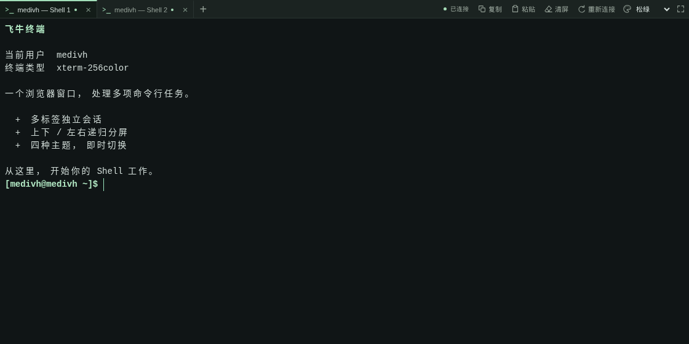
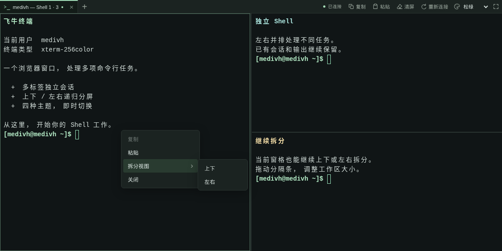
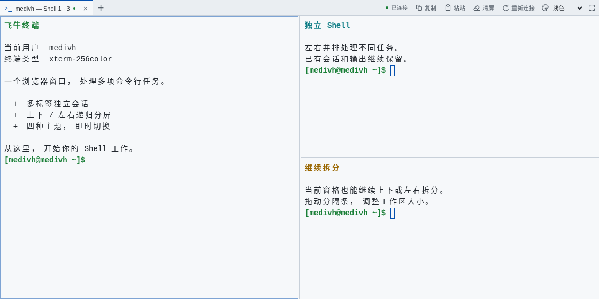

# 飞牛终端

在浏览器里打开 NAS 的命令行。

从飞牛桌面启动，即可以当前登录账号进入 Shell。用标签页切换任务，用分屏同时查看多个会话，也可以选择自己喜欢的终端主题。



_截图来自本地演示环境，展示应用实际界面。_

## 功能特点

- **当前账号登录**：以当前 NAS 用户身份执行命令，无需先开启 SSH，也不保存账号密码。
- **多标签会话**：每个标签拥有独立 Shell，切换标签保留输出。
- **递归分屏**：支持上下、左右拆分，分屏里的窗格还能继续拆分；拖动分隔条调整大小。
- **四种主题**：松绿、石墨、午夜蓝、浅色，切换即时生效，保留现有会话。
- **常用操作随手可用**：复制、粘贴、清屏、全屏、重新连接，以及终端右键菜单。
- **局域网与 FN ID 访问**：沿用飞牛登录状态，无需逐个用户填写访问来源地址。

## 界面预览

组合上下、左右分屏，在同一个工作区处理多项任务；右键可以继续拆分或关闭窗格。



浅色主题适合明亮环境。切换主题会同步改变界面和所有终端的配色。



## 安装使用

1. 在本仓库的 [Releases](https://github.com/medivh-jay/fn-terminal/releases) 页面下载对应 NAS 架构的 `.fpk`：x86 设备选择 `amd64`，ARM 设备选择 `arm64`。
2. 打开飞牛 **应用中心 → 手动安装**，选择下载的安装包。
3. 在安装或应用设置向导中启用“终端访问”，然后从飞牛桌面打开“终端”。

使用账号需要具备本应用的使用权限，并拥有可用的系统 Shell。首次安装默认关闭终端访问，由管理员启用。

<details>
<summary>通过应用坏心订阅更新</summary>

```text
https://github.com/medivh-jay/fn-terminal/releases/latest/download/fnpack.json
```

</details>

## 常用操作

| 操作             | 使用方式                              |
| ---------------- | ------------------------------------- |
| 新建会话         | 点击标签栏的 `+`                      |
| 左右分屏         | `Ctrl+(`，常见键盘对应 `Ctrl+Shift+9` |
| 上下分屏         | `Ctrl+)`，常见键盘对应 `Ctrl+Shift+0` |
| 打开终端菜单     | 在窗格内右键，或按 `Shift+F10`        |
| 调整窗格大小     | 拖动分隔条，或聚焦分隔条后使用方向键  |
| 复制、粘贴、清屏 | 使用顶部工具栏；复制前先选中文字      |
| 退出会话         | 输入 `exit`，自动关闭对应窗格         |

最后一个会话退出后，关闭当前应用窗口。普通浏览器手动打开的标签可能需要自行关闭。

## 使用说明

- 默认每个用户最多同时打开 **4 个会话**，标签页与分屏共用这个额度。
- 默认闲置 **15 分钟**，或会话持续 **1 小时**后断开，终端内会显示断开原因，之后按键也会提示重新连接；管理员可调整会话限制。
- 断线后点击“重新连接”会创建新的 Shell，不恢复原会话。
- 复制（工具栏按钮、右键菜单与键盘）在 HTTP 下也能使用；只有“粘贴”按钮需要 HTTPS 或可信本机环境，键盘粘贴（Ctrl+Shift+V / ⌘V）不受影响。
- 命令按当前用户的系统权限执行。终端中的文件操作会直接影响 NAS 上的实际文件。

## 开发与反馈

遇到问题可通过仓库 [Issues](https://github.com/medivh-jay/fn-terminal/issues) 反馈，附上飞牛系统版本、应用版本与错误信息。

本地运行、配置、架构说明、静态 manifest、FPK 打包和 GitHub 发版流程见 [开发与维护](docs/DEVELOPMENT.md)。

目前提供 x86 与 ARM 构建；ARM 真机兼容性与应用中心审核仍待验证。
